# RoboTwin

Data generation and evaluation for π0.5 on [RoboTwin 2.0](https://github.com/RoboTwin-Platform/RoboTwin)
(our fork is the `third_party/robotwin` submodule). Run everything from the `openpi` conda env,
which has openpi, RoboTwin and lerobot installed (setup: [main README](https://github.com/prachigarg23/self-supervised-continual-control#install-robotwin-sim)).
`$REPO` is the root of this repository.

## Test sets

### Default embodiment

Example rollouts on test seeds (front-facing head camera). Long rollouts are time-compressed.

**T<sub>SS</sub> — Self-Supervised Tasks**

<table>
<tr><td align="center">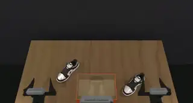<br><sub>place dual shoes</sub></td><td align="center">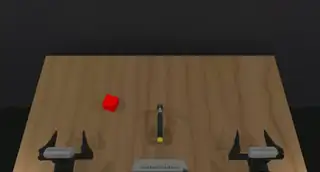<br><sub>beat block hammer</sub></td><td align="center">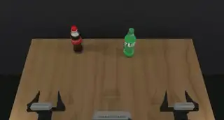<br><sub>pick dual bottles</sub></td><td align="center">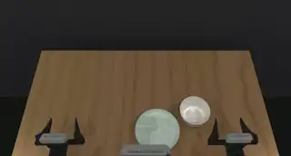<br><sub>place container plate</sub></td><td align="center">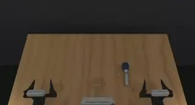<br><sub>handover mic</sub></td></tr>
<tr><td align="center">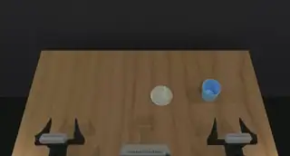<br><sub>place empty cup</sub></td><td align="center">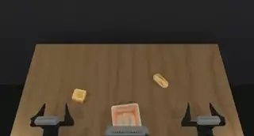<br><sub>place bread basket</sub></td><td align="center">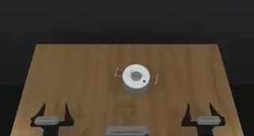<br><sub>lift pot</sub></td><td align="center">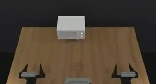<br><sub>open microwave</sub></td><td align="center">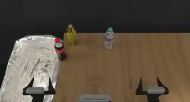<br><sub>put bottles dustbin</sub></td></tr>
</table>

**T<sub>ES</sub> — Expert-Supervised Tasks**

<table>
<tr><td align="center">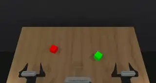<br><sub>stack blocks red on green</sub></td><td align="center">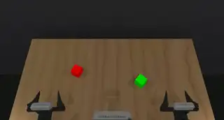<br><sub>stack blocks green on red</sub></td></tr>
</table>

**T<sub>NO</sub> — Novel Object Tasks**

<table>
<tr><td align="center">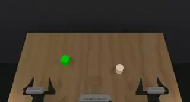<br><sub>stack cylinder on cube</sub></td><td align="center">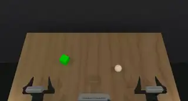<br><sub>stack sphere on cube</sub></td><td align="center">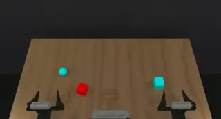<br><sub>stack sphere on cube, distractor</sub></td><td align="center">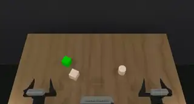<br><sub>stack cylinder on cube, distractor</sub></td></tr>
</table>

**T<sub>NC</sub> — Novel Composition Tasks**

<table>
<tr><td align="center">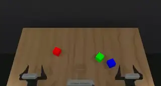<br><sub>stack blocks three</sub></td><td align="center">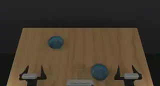<br><sub>stack bowls two</sub></td><td align="center">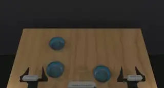<br><sub>stack bowls three</sub></td></tr>
</table>

---

### Top-view embodiment

Scripted expert demonstrations of the expert-supervised tasks (head camera moved overhead; `task_config/demo_clean_topview.yml`).

<table>
<tr><td align="center">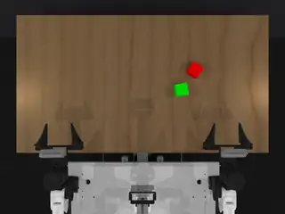<br><sub>stack blocks red on green</sub></td><td align="center">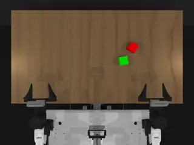<br><sub>stack blocks green on red</sub></td></tr>
</table>

## 1. Data

Both pipelines end with a LeRobot dataset pushed to the Hugging Face Hub (`hf auth login` first).
Every episode gets its task's fixed prompt from `third_party/robotwin/task_prompts.json`.

**Expert demonstrations** (RoboTwin's scripted planner):

```bash
bash $REPO/examples/robotwin/build_expert_dataset_pipeline.sh <task_config> <episodes> <dataset_name> <hf_repo_id> <task> [<task> ...]

# e.g. Stage 2 data (stack blocks), 50 episodes per task
bash $REPO/examples/robotwin/build_expert_dataset_pipeline.sh demo_clean 50 stage2 <hf_user>/stack_blocks \
    stack_blocks_two_green_on_red stack_blocks_two_red_on_green
```

**Self-demonstrations** (rollouts of a trained policy on the 10 Stage-1 tasks; successes and failures kept):

```bash
bash $REPO/examples/robotwin/build_selfdemo_dataset_pipeline.sh <ckpt_step_dir> <train_config> <run_name> <rollouts_per_task> <hf_repo_id> [task_config] [exec_horizon]

# e.g. 50 rollouts per task from the Stage-1 checkpoint
CUDA_VISIBLE_DEVICES=0 bash $REPO/examples/robotwin/build_selfdemo_dataset_pipeline.sh \
    $REPO/checkpoints/pi05_FAST_robotwin_mid_training/paper/10000 pi05_FAST_robotwin_mid_training \
    S1_rollouts_50 50 <hf_user>/robotwin_500_policy_rollouts
```

| | Raw data | Processed (ALOHA hdf5) |
|---|---|---|
| Expert | `third_party/robotwin/data/<task>/<task_config>/` | `examples/robotwin/processed_data/<dataset_name>/` |
| Self-demos | `third_party/robotwin/S1_policy_generated_data/<run_name>/` | `third_party/robotwin/S1_policy_generated_data/processed_<run_name>/` |

`example_stage1_dataset.sh` and `example_stage2_dataset.sh` are the scripts used for the Stage-1 and Stage-2 datasets.

## 2. Evaluation

Each run evaluates a checkpoint on 50 fixed scenes per task. Per-task success rates go to
`<log_dir>/summary.tsv` (test), `results.csv` (validation) or `ood_results.csv` (OOD).
Re-running the same command resumes and skips finished tasks.

```bash
cd $REPO/third_party/robotwin

# Test set (Stage-1 tasks, Stage-2 tasks and OOD tasks)
CUDA_VISIBLE_DEVICES=0 python run_test_tasks.py --ckpt2 <ckpt_step_dir> --cfg2 <train_config> \
    --log_dir logdir_test_results_H25/<run_name> --exec_horizon 25

# Validation set
python run_validation_tasks.py --ckpt2 <ckpt_step_dir> --cfg2 <train_config> --log_dir <log_dir> --exec_horizon 25

# OOD object shapes/colors (sphere, cylinder, with/without distractor)
python run_ood_test.py --ckpt <ckpt_step_dir> --cfg <train_config> --log_dir <log_dir> --exec_horizon 25
```

- Top-view camera: add `--task_config demo_clean_eval_topview` to `run_test_tasks.py`.
- Check that the run log (`stage2.log`, or `ood_eval.log` for OOD) prints `exec_horizon=25 (chunk size=50)`.
